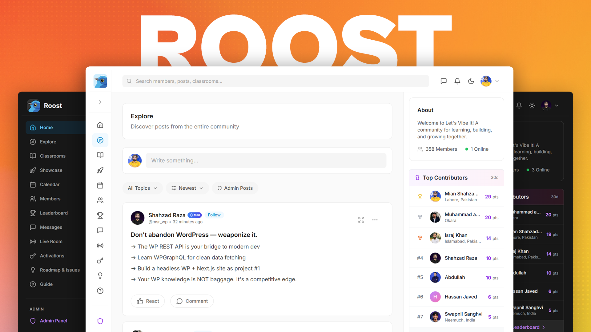

<div align="center">

<a href="https://roost.msrbuilds.com/">
  
</a>

# Roost

**The open-source home for your community.**

A free, self-hosted alternative to Skool, Circle, and similar community platforms.<br />
Bring conversations, classrooms, courses, and events together on infrastructure you control.

[](LICENSE)
[](guides/self-hosted-setup.md)
[](https://github.com/msrbuilds/roost/actions/workflows/website.yml)
[](https://github.com/msrbuilds/roost/stargazers)

### [Website](https://roost.msrbuilds.com/) · [Try the live demo](https://roost-demo.msrbuilds.com/) · [Documentation](https://roost.msrbuilds.com/docs/) · [Watch the intro](https://www.youtube.com/watch?v=XVmHSLuBeNU)

**MIT licensed · Customizable branding · No per-member platform fees**

</div>

---

[Features](#features) · [Quick start](#quick-start) · [Deployment](#deployment) · [Documentation](#documentation) · [Development](#development) · [License](#license)

## Why Roost?

Roost gives teachers, creators, and independent communities a shared place to learn, build, and connect. Run it on your own infrastructure, connect your domain, and adapt the source to your community.

- **Keep control.** Direct access to your code, database, and files.
- **Bring your tools together.** Discussions, learning, messaging, and events in one platform.
- **Choose your setup.** Use managed Supabase or run the backend stack yourself.
- **Make it yours.** Customize the branding, enable the features you need, and contribute improvements.

> **Free software, with real operating costs.** Roost has no software license or per-member platform fee. You cover hosting, storage, email, and any optional external services you use. Self-hosting also means managing updates, security, and backups.

## Features

| | Feature | What you can do |
| :---: | --- | --- |
| 💬 | **Community feed** | Publish rich-text posts, share media, comment, and react. |
| 📚 | **Groups & classrooms** | Create public or private spaces with admin, moderator, and member roles. |
| 🎓 | **Courses & lessons** | Organize modules, embed video lessons, and track learning progress. |
| ✉️ | **Direct messaging** | Connect through real-time one-to-one chat and file attachments. |
| 📅 | **Events & calendar** | Schedule community events and manage RSVPs. |
| 👥 | **Member directory** | Find members through searchable profiles and online status. |
| 🏆 | **Leaderboards** | Recognize participation through points and contribution rankings. |
| 🚀 | **Project showcases** | Share member projects with voting and reviews. |
| 🗺️ | **Community roadmap** | Collect feature requests, bug reports, and community votes. |
| 📺 | **Live room** | Bring live-session embeds, recordings, and real-time chat together. |
| 🔔 | **Notifications** | Keep members informed with in-app and configured email notifications. |
| 🛡️ | **Administration** | Manage users, roles, content, branding, and community settings. |

Optional integrations include S3-compatible storage, SMTP or Brevo email, Redis, and Stripe membership billing. Configure and test the integrations you enable; paid memberships are disabled in the shared demo.

**[Explore all features →](https://roost.msrbuilds.com/features/)**

## Try it first

The **[live demo](https://roost-demo.msrbuilds.com/)** includes a prefilled shared member login and fictional sample content. Browse the feed, classrooms, calendar, messages, profiles, and showcases.

The shared demo is **read-only**. Account changes, content writes, uploads, and paid memberships are disabled. For a writable installation with an owner account, see the [local sample community](#local-sample-community).

## Quick start

### Interactive installer — recommended

Run the installer in a Bash environment:

```bash
git clone https://github.com/msrbuilds/roost.git
cd roost
bash install.sh
```

The installer walks through:

1. Community name, branding, and domain.
2. Supabase Cloud or self-hosted Supabase.
3. Docker VPS, Dokploy, Vercel, Netlify, or local development.
4. File storage, account email, and optional integrations.

The Docker VPS path includes Traefik and Let's Encrypt HTTPS, with an optional MinIO profile. The self-hosted Supabase path can generate JWT, anon, and service keys and Dokploy-ready environment values.

**Continue with the [getting started guide](guides/self-hosted-setup.md)** for database initialization, your first admin account, and production configuration. The [installer guide](guides/install-script.md) explains each setup path.

<details>
<summary><strong>Manual setup for local development</strong></summary>

Use Node.js 22+ and npm. You will also need a configured Supabase project, S3-compatible file storage, and account email delivery. See the [setup prerequisites](guides/self-hosted-setup.md#prerequisites).

```bash
git clone https://github.com/msrbuilds/roost.git
cd roost
npm ci
npm ci --prefix server

cp .env.example .env.local
cp server/.env.example server/.env
```

Edit both environment files, initialize the database using `schema.sql`, and follow the [first-admin instructions](guides/self-hosted-setup.md#3-create-first-admin-user).

```bash
npm run dev:all
```

The frontend runs at `http://localhost:5000` and the API at `http://localhost:3000` by default. You can also start them separately with `npm run dev` and `npm run dev:server`.

</details>

## Deployment

| Option | What it runs | Guide |
| --- | --- | --- |
| **Docker on a VPS** | Frontend and API with Docker Compose, Traefik, and HTTPS | [Docker VPS](guides/docker-vps.md) |
| **Dokploy on a VPS** | Full self-hosted stack with Supabase and private storage | [Dokploy setup](guides/dockploy-vps.md) |
| **Vercel** | Frontend; API and backend services are hosted separately | [Vercel frontend](guides/vercel.md) |
| **Netlify** | Frontend; API and backend services are hosted separately | [Netlify frontend](guides/netlify.md) |

| Database option | Best fit | Guide |
| --- | --- | --- |
| **Supabase Cloud** | Managed Postgres and authentication | [Cloud setup](guides/supabase-cloud.md) |
| **Self-hosted Supabase** | Operate the database and authentication yourself | [Self-hosted setup](guides/supabase-selfhosted.md) |

## Documentation

| Start here | Run your community | Operate your installation |
| --- | --- | --- |
| [Getting started](guides/self-hosted-setup.md) | [Member walkthrough](guides/using-roost.md) | [Backups & recovery](guides/backups.md) |
| [Interactive installer](guides/install-script.md) | [Administration](guides/administration.md) | [Installation checks](guides/staging-tests.md) |
| [Deployment guide index](guides/docker-dokploy.md) | [Shared demo setup](guides/live-demo.md) | [Troubleshooting](guides/dockploy-vps-troubleshooting.md) |

Browse the **[searchable documentation website](https://roost.msrbuilds.com/docs/)** for all guides, including illustrated member and admin walkthroughs.

## Tech stack


| Layer | Technologies |
| --- | --- |
| **Frontend** | React 19, TypeScript, Vite, Tailwind CSS, Lucide icons |
| **API** | Node.js 22+, Express, Zod, Helmet |
| **Data & auth** | PostgreSQL and Supabase Auth, Realtime, and APIs |
| **Files** | S3-compatible storage, including AWS S3, MinIO, Cloudflare R2, and DigitalOcean Spaces |
| **Email & billing** | SMTP or Brevo; optional Stripe memberships |
| **Content** | Sanitized rich-text editor and embedded video lessons |
| **Testing** | Vitest, Testing Library, and Playwright |
| **Product website** | Astro and Pagefind documentation search |

## Configuration

Use [`.env.example`](.env.example) for frontend settings and [`server/.env.example`](server/.env.example) for backend settings. The installer also generates the Compose `.env` file required for container deployments.

<details>
<summary><strong>Feature flags</strong></summary>

| Variable | Default | Purpose |
| --- | --- | --- |
| `VITE_ENABLE_SIGNUP` | `true` | Allow new account registration |
| `VITE_ENABLE_SHOWCASE` | `true` | Enable the project showcase |
| `VITE_ENABLE_LIVE_ROOM` | `true` | Enable the live room |
| `VITE_ENABLE_LEADERBOARD` | `true` | Enable points and leaderboards |
| `VITE_ENABLE_ACTIVATIONS` | `false` | Enable product activations |

Frontend flags are applied when the app is built. Configure backend services and permissions separately; a frontend flag is not an access-control boundary.

</details>

## Development

After completing local setup:

```bash
npm run dev:all       # Frontend and API
npm run check         # TypeScript, lint, and unit tests
npm test             # Unit tests in watch mode
npm run test:e2e      # Browser tests
```

To work on the product website and docs, see [`website/README.md`](website/README.md).

<details>
<summary><strong>Project structure</strong></summary>

```text
roost/
├── src/                        # React application
│   ├── auth/                   # Auth interfaces and Supabase adapter
│   ├── db/                     # Database interfaces and Supabase adapter
│   ├── components/             # UI components
│   ├── config/                 # Branding and feature configuration
│   ├── contexts/               # Shared application state
│   ├── hooks/                  # React hooks
│   ├── layouts/                # Member, admin, and auth layouts
│   ├── pages/                  # Application screens
│   ├── services/               # Data and API services
│   └── types/                  # TypeScript contracts
├── server/src/                 # Express routes, services, and utilities
├── e2e/                        # Playwright browser tests
├── guides/                     # Setup and operation guides
├── website/                    # Astro product website and docs
├── schema.sql                  # Fresh-install database schema
├── install.sh                  # Interactive installer
├── docker-compose.yml          # Docker deployment
├── docker-compose.dokploy.yml  # Dokploy deployment
├── docker-compose.local.yml    # Loopback-only sample installation
├── Dockerfile                  # Frontend container
├── nginx.conf                  # Frontend Nginx configuration
├── vercel.json                 # Vercel configuration
└── netlify.toml                # Netlify configuration
```

</details>

## Local sample community

<details>
<summary><strong>Run a writable sample installation with an owner account</strong></summary>

This loopback-only installation is separate from the public demo. It has its own volumes, private storage, fictional sample data, and Mailpit inbox. Use Docker Desktop with Linux containers and Docker Compose v2. These settings are for local development, not public deployment.

```bash
node scripts/create-screenshot-env.cjs

docker compose --env-file .env.screenshots.local -p roost-screenshots -f docker-compose.dokploy.yml -f docker-compose.local.yml up -d --build

docker compose --env-file .env.screenshots.local -p roost-screenshots -f docker-compose.dokploy.yml -f docker-compose.local.yml exec -T -e ROOST_SCREENSHOT_SEED=true backend node scripts/seed-screenshots.cjs
```

- **App:** `http://127.0.0.1:15489`
- **Private email inbox:** `http://127.0.0.1:15490`
- **Sample member:** `demo@roost.example` / `ExploreRoost2026!`
- **Owner:** `owner@roost.example`; find the generated `LOCAL_ADMIN_PASSWORD` in the ignored `.env.screenshots.local` file.

Stripe is disabled. The environment generator refuses to overwrite its file, and the fixture seed refuses non-local origins or databases containing non-fixture users.

Stop the installation while keeping its data:

```bash
docker compose --env-file .env.screenshots.local -p roost-screenshots -f docker-compose.dokploy.yml -f docker-compose.local.yml stop
```

Follow [Using Roost](guides/using-roost.md) and [Administration](guides/administration.md) for the member and owner walkthroughs.

</details>

## Contributing

Found a bug or have an idea? [Open an issue](https://github.com/msrbuilds/roost/issues). Pull requests for fixes, documentation, and improvements are welcome. Include clear reproduction steps or a description of the change, and run the relevant checks before submitting. Setup, checks, and pull request expectations are in [CONTRIBUTING.md](CONTRIBUTING.md).

## License

Roost is available under the **[MIT License](LICENSE)**. You can use, modify, and self-host it under the license terms. Third-party services and dependencies have their own terms and costs.

---

<div align="center">

**Built by [MSR Builds](https://msrbuilds.com/). Open to your community.**<br />
If Roost helps you, consider [starring the repository](https://github.com/msrbuilds/roost).

</div>
