# Administration

Use the **Admin Panel** link from a privileged account. This guide shows the actual admin interface in a private local Roost installation with fictional data. Select any screenshot to open the full-size capture. Admin access is deliberately unavailable in the shared public demo.

## Understand roles

Platform roles and classroom roles are separate. A platform **superadmin** controls privileged role assignments. **Admins** manage the community. **Moderators** have the content, showcase, and activation tools assigned to their role. A classroom administrator manages their classroom's learning content without automatically becoming a platform admin.

Create your initial owner using the bootstrap steps in [Getting started](./self-hosted-setup.md). Keep privileged accounts private and enable two-factor authentication from account settings.

## Check community activity

The **Dashboard** summarizes members, posts, comments, upcoming events, groups, announcements, and banned accounts. Activity and member-growth charts cover the last 30 days, including today. Contributor totals use the same rolling-period calculation as the member leaderboard.

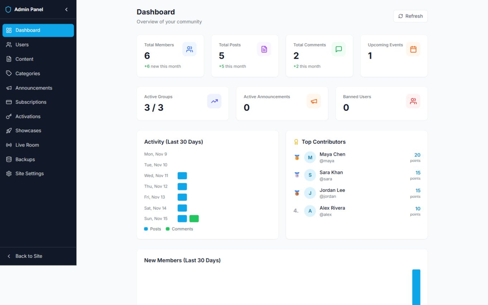

## Manage members and permissions

Open **Users** and search by name or username, or filter by role. The table shows role, free or premium membership, status, and join date. Use a member's action menu for the actions your role permits, including membership updates and bans. Review the member and reason before applying a ban; time-limited bans expire automatically.

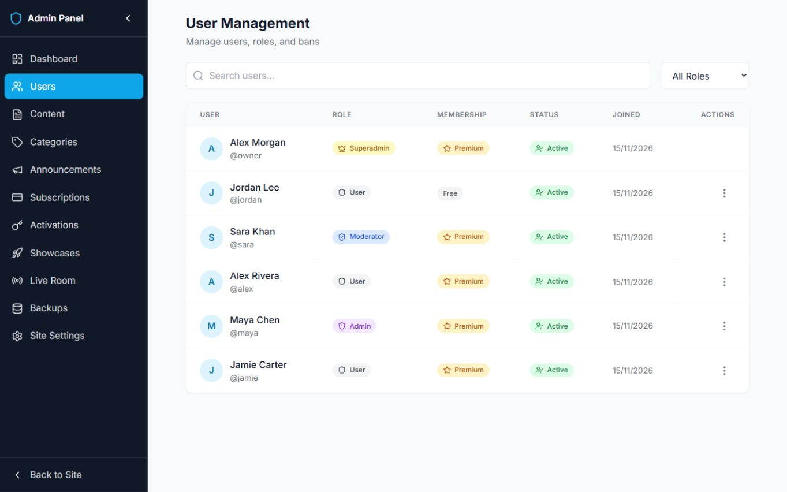

Superadmin role controls govern privileged access. Grant only the role a person needs. A membership label controls access rules; it does not by itself create a Stripe subscription or payment.

## Moderate posts and comments

Use **Content** to inspect posts and comments, search the content list, and manage inappropriate or misplaced material. Check the author and surrounding conversation before changing or deleting content. Deletion can remove associated material and should be treated as permanent.

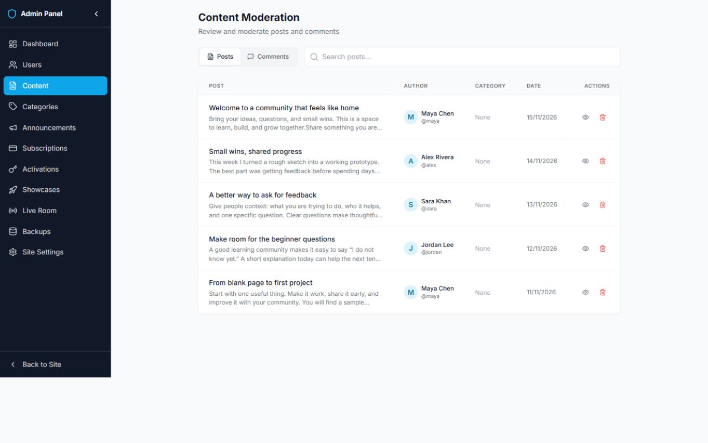

## Organize categories and announcements

**Categories** lets you add, edit, and order post topics. Use descriptive names that help members find the right conversation.

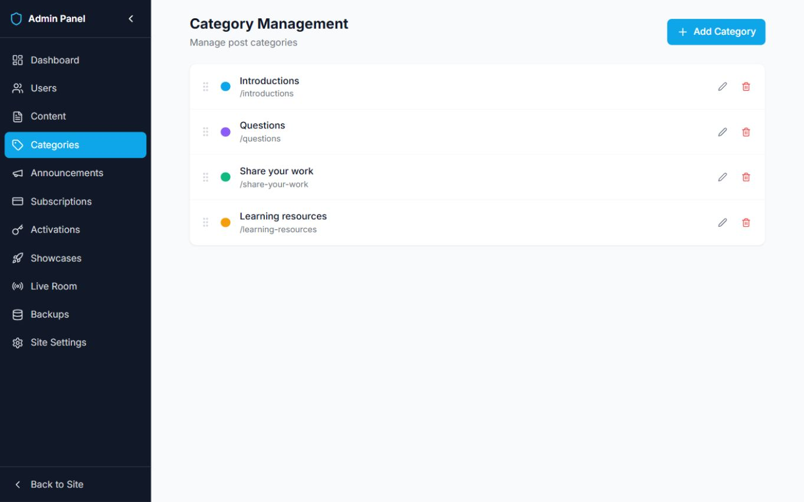

**Announcements** manages notices for the whole site or a selected group. Create a notice, choose its scope and active state, and review the message before publishing. The sample below is inactive.

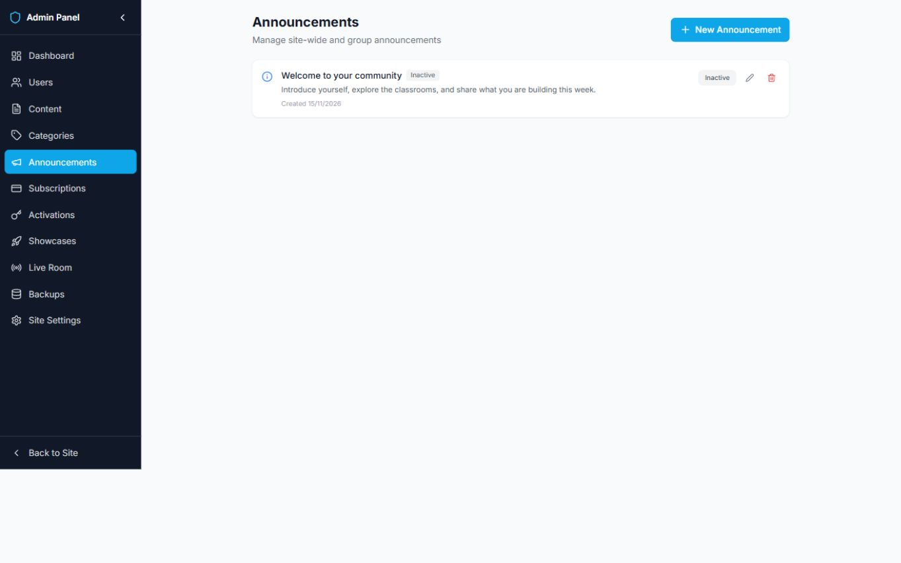

## Review project submissions

In **Showcases**, review pending projects before approval. Inspect the submission and its destination, then approve or reject it. Approved, featured, rejected, and all-submission filters help you return to previous decisions.

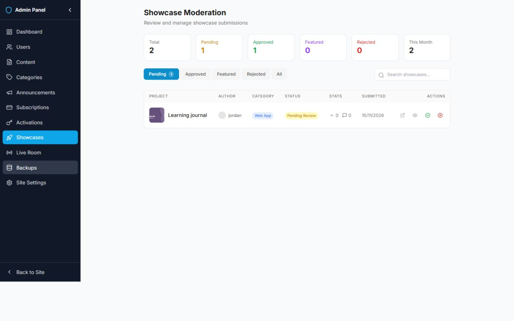

## Customize branding and feature access

**Site Settings** controls the community name, tagline, description, theme logos, favicon, brand color, and support details. Use **Save Changes** to apply your edits. Storage must be configured for image uploads.

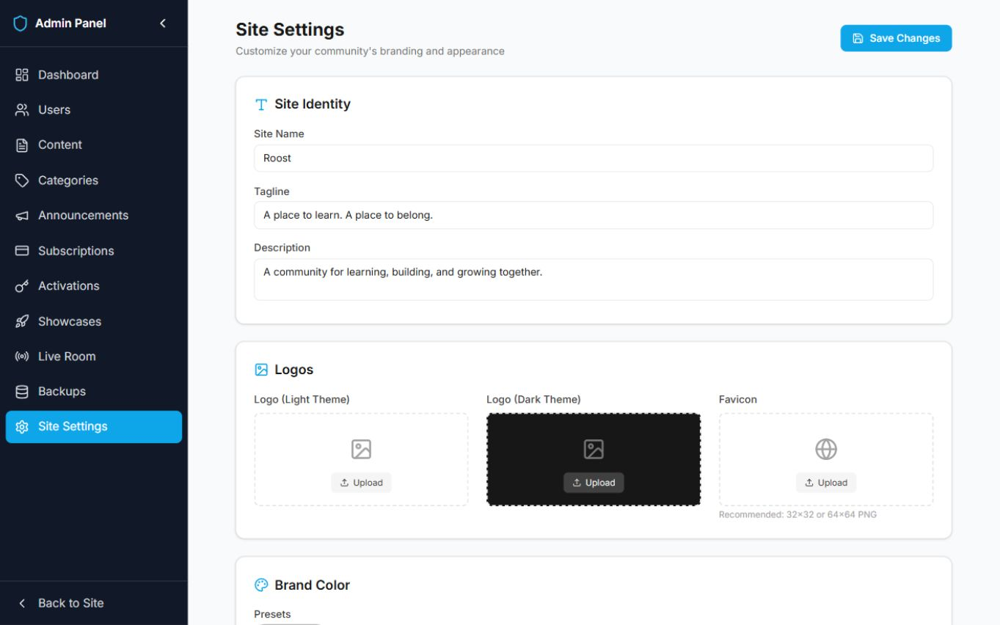

Under **Feature Modules**, choose **Everyone**, **Premium Only**, or **Disabled** for Live Room, Activations, Roadmap & Issues, and Showcase. Access settings affect navigation and feature availability; configure the corresponding service before making a feature available.

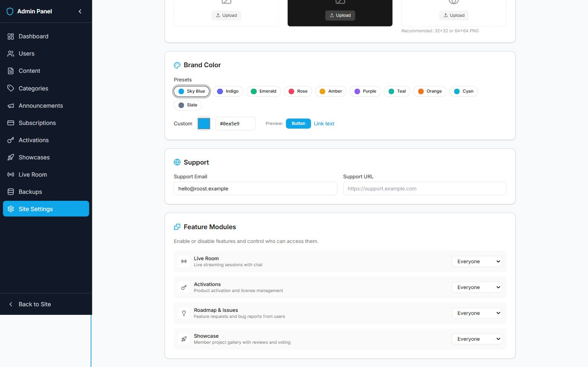

## Manage optional live sessions and activations

**Live Room** manages a broadcast's title, description, video source, and schedule. Verify the video and access settings before going live. The illustrated workshop is scheduled and idle, with no broadcast running.

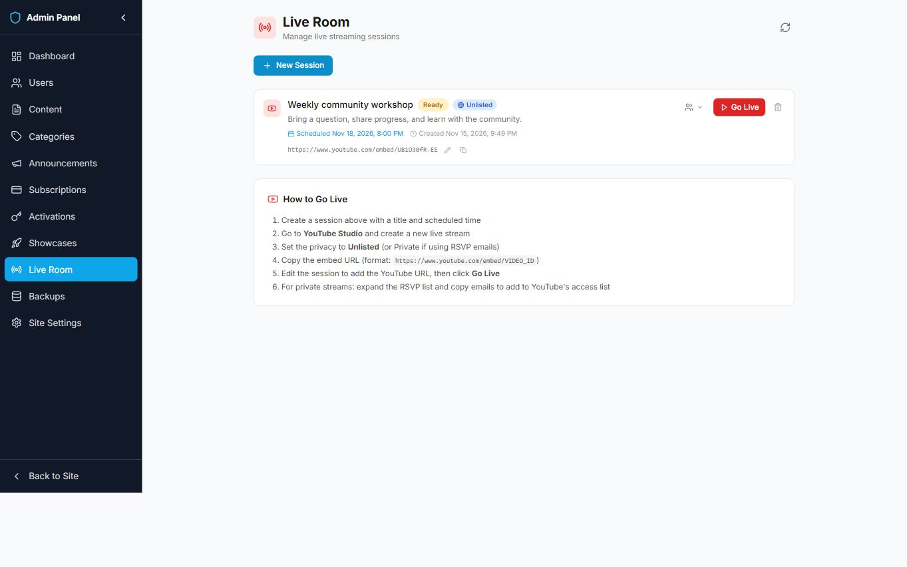

**Activations** manages product definitions and member activation requests. Review a request and provide only the access information appropriate for that member. The illustrated request uses example.com and contains no real license keys or credentials.

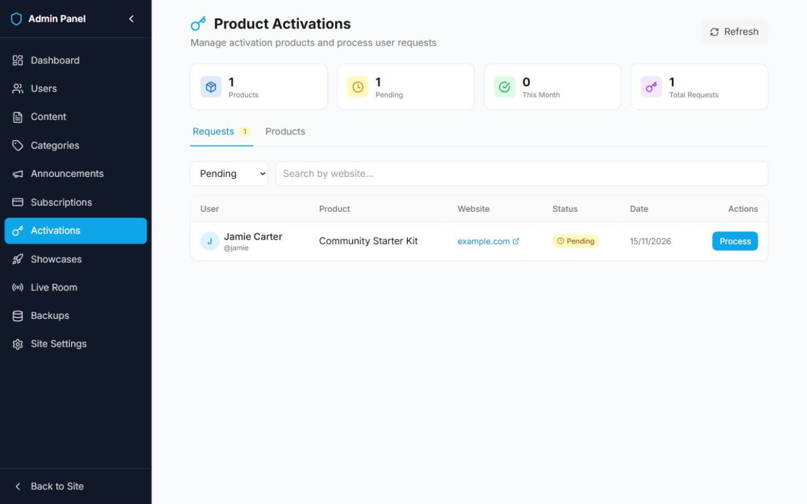

**Subscriptions** is relevant only when paid memberships and Stripe are configured. The sample local install and shared public demo keep paid checkout disabled.

## Create and verify backups

Open **Backups**, choose **Create Backup Now**, and wait for a successful result. The history lists stored backup files and offers authorized downloads. This screenshot shows a real backup of the fictional local database.

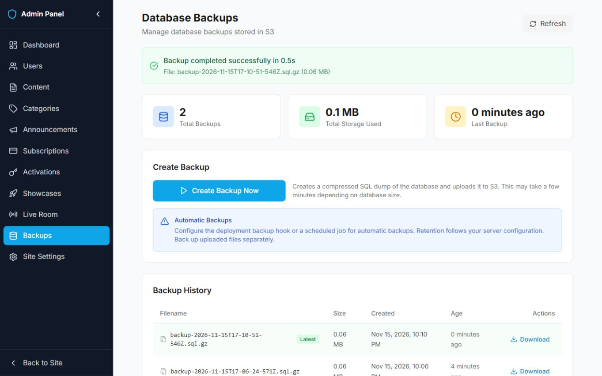

A backup beside the application is useful for testing, but it does not protect against losing the host. Configure a private offsite destination, an automated backup schedule, and restore tests before relying on it for production. Automatic deployment backups require the documented deployment hook; they are not guaranteed by every hosting method. Database dumps do not replace a separate backup of uploaded files.

Follow [Backups & recovery](./backups.md) for destination configuration, command-line operation, retention, and restore verification.
