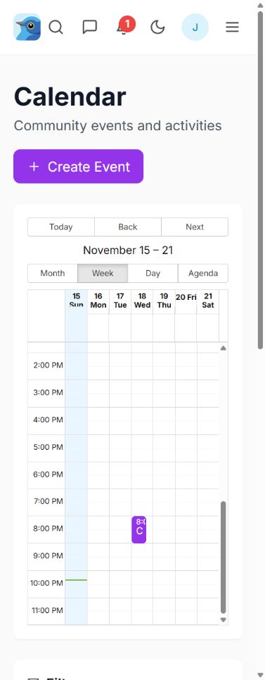
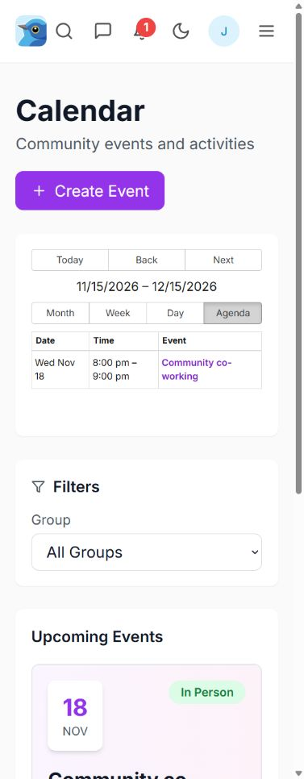
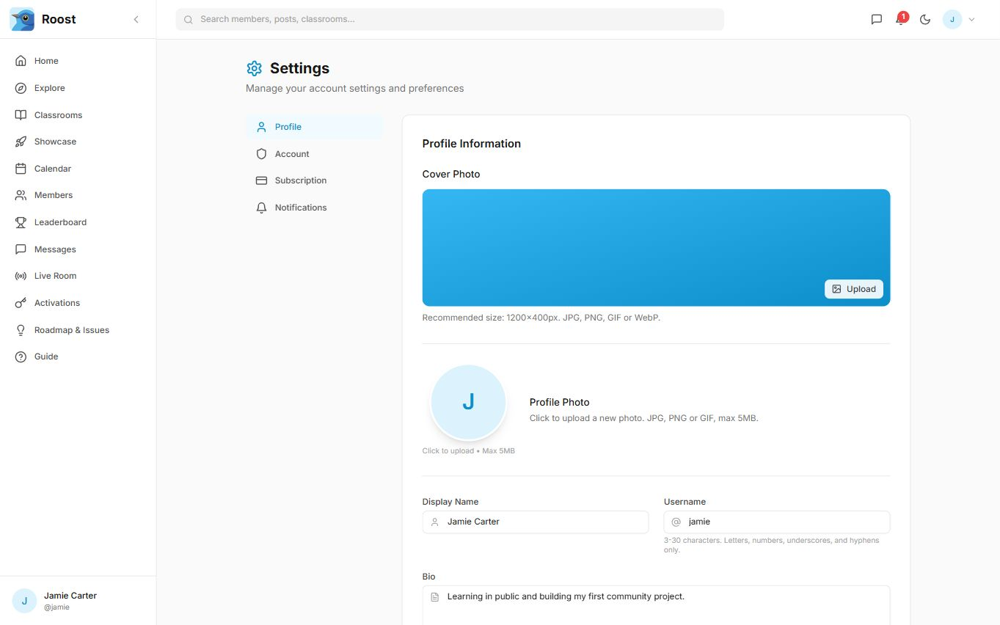

# Using Roost

A visual walkthrough of the member experience. Screenshots come from a full local installation with fictional accounts and content. Select a screenshot to open it at full size. The public live demo is read-only; your own installation supports the actions described here.

## Sign in and find your way around

Use **Login** with your community account. New members can use **Sign Up** when registration is available; confirmation and password-reset email depend on your administrator's email configuration.

The sidebar takes you to the feed, classrooms, members, messages, and calendar. On a phone, open the navigation menu to find the same destinations. Some optional destinations depend on the community's feature settings and your membership.

## Join the conversation

On **Home**, choose **Write something…** to create a post. Add a title if useful, write your message, and publish. Open a post to read it in context, react, or add a comment. Pinned posts keep important community information near the top.

Follow people whose updates interest you. The feed's topic and sorting controls help you find relevant conversations.

## Learn in classrooms

Open **Classrooms** to discover learning spaces or return to **My Classrooms**. A card shows the classroom description, membership count, and your membership state. Public and private classrooms have different access rules.

Open a classroom, choose a module, then select a lesson. Lessons can combine an embedded video, progress controls, and a discussion. Use **Mark Complete** when you finish; use **Assets** in the module to find supplied learning materials.

The sample video is HTML Crash Course for Absolute Beginners by Traversy Media, embedded from their public YouTube channel.

## Meet members and send a message

Search **Members** for people, read their biographies, and open a profile or **Message** link. In **Messages**, choose a conversation or start a new one. Write a message, attach supported images when needed, and use the send button or **Ctrl+Enter**.

## Find events and RSVP

The **Calendar** offers **Month**, **Week**, **Day**, and **Agenda** views. Use **Today**, **Back**, and **Next** to change the visible dates. Group filters narrow the schedule. Select an event for its details; choose **Going**, **Maybe**, or **Can't Go** to update your RSVP.

On smaller screens, Week keeps day labels visible and Agenda presents the schedule in a compact table.

## Share work and suggest improvements

Use **Showcase** to discover member projects and submit your own. Submissions may need approval before appearing publicly. Open a project to view its overview, reviews, and website link.

Use **Roadmap & Issues** for feature ideas, improvements, and bug reports. Search before submitting, vote on useful requests, and check their status. **Leaderboard** highlights community contributions over the selected time period.

## Update your profile and preferences

Open the account menu and choose **Settings**. Update your display name, biography, location, website, and profile images. Other tabs contain account, membership, and notification settings. Save changes before leaving a form.

**Live Room** and **Activations** appear only when enabled for your account. Live Room is for community broadcasts and chat. Activations lets members request access to products configured by the administrator. Paid membership checkout is optional and requires a separately configured Stripe integration.

Community owners should continue with [Administration](./administration.md).
